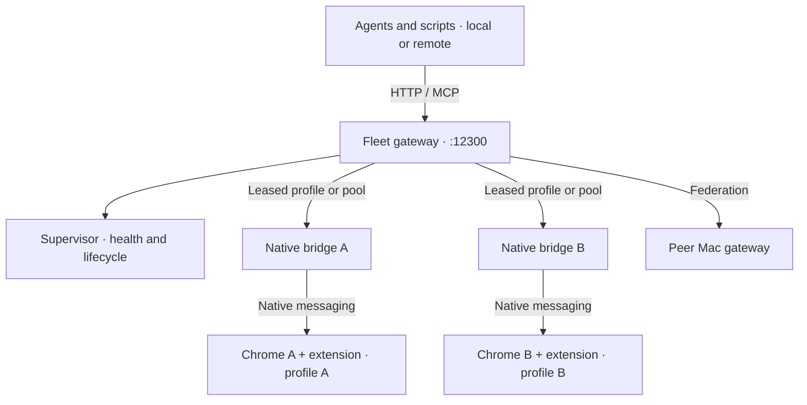

<div align="center">


# HumanChrome

**A native Chrome fleet for AI agents. Real browsers. Persistent logins. Parallel work.**

Turn a Mac into a pool of signed-in Chrome browsers that agents can use from another computer over **MCP or HTTP**. Clone an existing profile, give agents separate browsers, and run workflows in parallel without sharing one active tab. Start with one Mac; federate more machines behind the same gateway when you need more capacity.

_Built by Mihai Mateias. I use it daily to drive my own coding agents._

[](LICENSE)


</div>

## More than a Chrome extension

The extension is how HumanChrome acts inside a browser. The fleet is how you run many of them.

HumanChrome combines a **Chrome extension**, a **native bridge**, and a **fleet supervisor and gateway**. It runs full Chrome processes directly on macOS — no Docker or headless browser required — with persistent profiles, cookies, and website storage. Your agents can run elsewhere: a laptop, a server, or another machine on your private network.

- **One browser or a fleet.** Control your everyday Chrome, or provision separate Chrome processes and profiles for parallel agents.
- **Bring your signed-in session.** Seed fleet profiles from this Mac's daily Chrome or another user-data directory, or clone a reusable template. Each copy keeps its own state afterward; it is not a live cookie-sync service.
- **Parallel work, not one shared active tab.** Separate browsers give agents independent tab sets. Fleet leases keep agents from taking the same browser; per-client tab ownership and per-tab locks coordinate work inside a browser.
- **A remote browser resource.** Discover available profiles, provision them over HTTP, start/stop/restart browsers over HTTP or MCP, and route browser actions to a named profile or a labeled pool.
- **Supervised, not disposable.** Health checks, crash recovery with backoff, and a launchd service keep the fleet available.
- **One Mac now, more later.** Peer gateways expose browsers across machines through named routes and pooled access.

[Fleet setup and operations →](docs/FLEET.md) · [Browser tool reference →](docs/TOOLS.md)

## What agents can do

Navigate, click, fill forms, scroll, read page content, take screenshots, run JavaScript, handle dialogs, upload files, inspect console output, capture network traffic, and intercept fetch/XHR responses. The same browser tool catalog is available through MCP and a plain HTTP API with a generated OpenAPI spec.

Use it for parallel research, signed-in business apps, messaging workflows, and repetitive website tasks. One agent can work in one browser while another works in a different browser — without borrowing your mouse or making every workflow compete for one tab.

MCP clients include Claude Code, Claude Desktop, Cursor, Codex CLI, Continue, and Cherry Studio. Scripts and custom agent runtimes can use HTTP directly.

## Why native Chrome?

A fresh browser often means starting from zero: no login, no website storage, no paired session. HumanChrome can work in your existing Chrome or copy its profile into dedicated fleet browsers on the same Mac. The browser runs on the host's normal OS and network stack rather than requiring a containerized browser environment.

That is useful for signed-in workflows on sites such as LinkedIn, WhatsApp Web, Facebook, Instagram, and Tinder. It does **not** make automation undetectable: sites can still evaluate behavior, IP reputation, concurrent sessions, and other signals, challenge a login, or restrict an account. Use accounts you are authorized to control and respect each site's rules.

## How it works



The fleet gateway handles routing and leases; each browser has its own bridge and extension. Browser actions run inside the selected profile. For single-browser use, connect directly to its local bridge on `127.0.0.1:12306` — no fleet required.

There is also a **read-only web dashboard** at the gateway root (`/` or `/ui`) for profile health, leases, and launch errors. Browser lifecycle control is through the CLI, HTTP API, or fleet MCP tools, not dashboard buttons.

See [architecture](docs/ARCHITECTURE.md) for the browser/bridge internals and [fleet operations](docs/FLEET.md) for deployment, security, and multi-machine routing.

## Install

HumanChrome needs Node 24+ and pnpm, plus Google Chrome or Chromium. Quickstart:

```bash
# 1. Clone and build the bridge (Node 24+, pnpm)
git clone https://github.com/cefege/humanchrome.git
cd humanchrome
pnpm install
pnpm --filter humanchrome-bridge build
pnpm build:extension

# 2. Deploy to a stable install dir outside the repo, then install globally
SAFE_DIR="$HOME/Library/Application Support/humanchrome-bridge"
pnpm deploy --filter humanchrome-bridge --prod --legacy "$SAFE_DIR"
npm install -g "$SAFE_DIR"

# 3. Register the native messaging host
humanchrome-bridge register
```

> **Why deploy outside the repo.** Don't `npm install -g ./app/native-server`
> from inside the workspace — pnpm intercepts that and creates a global symlink
> back into the repo, which on macOS often sits under `~/Documents`. That
> matters because macOS TCC blocks Chrome from `exec()`'ing scripts under
> `~/Documents`, `~/Desktop`, `~/Downloads`, `~/Pictures`, `~/Movies`,
> `~/Music`, or iCloud Drive — even with Full Disk Access. Registration
> succeeds but every `connectNative()` silently fails, with Chrome reporting
> `Native host has exited.` `humanchrome-bridge register` refuses to write a
> manifest pointing into a TCC-protected dir, and `humanchrome-bridge doctor`
> flags existing bad manifests from earlier installs.

4. For **single-browser mode**, load the extension in Chrome (fleet provisioning loads it automatically):
   - Go to `chrome://extensions/`, enable Developer mode.
   - "Load unpacked" → pick `app/chrome-extension/.output/chrome-mv3/` from your clone (or the released zip from the GitHub Releases tab).
   - Click the extension icon, then **Connect**.

5. For single-browser mode, confirm the bridge is up:

```bash
curl http://127.0.0.1:12306/ping
# {"status":"ok","message":"pong"}
```

### Turn a Mac into a browser fleet

After building and registering the bridge above, follow the [Mac setup prerequisites](docs/FLEET.md#mac-setup): the fleet needs a logged-in GUI session with an accessible login Keychain. The extension build deploys to the fleet's default extension directory.

```bash
# Initialize the fleet and enable client authentication.
# This rotates credentials on an existing fleet; run once during setup.
humanchrome-bridge fleet init --force-new-token

# Keep the supervisor in the Mac's GUI session, including for SSH callers.
humanchrome-bridge fleet install-agent

# Make independent browsers from this Mac's signed-in Chrome.
humanchrome-bridge fleet profile add research-01 --seed daily --labels research
humanchrome-bridge fleet profile add research-02 --seed daily --labels research

humanchrome-bridge fleet status
```

Seeding copies sensitive session data. The fleet refuses launches that cannot access the login Keychain, checks that copied cookies survive first launch, and verifies a live Google session when the source supplied a Google login. A copy cannot revive an expired or revoked session. See [session checks](docs/FLEET.md#where-a-profile-is-launched-and-the-cookie-gate).

From another computer, configure two MCP connections: one for browser work and one for fleet control. Replace `mac-host`, `YOUR_FLEET_TOKEN`, and `research-agent-1`; get the token privately with `humanchrome-bridge fleet init --print-token`.

```json
{
  "mcpServers": {
    "humanchrome": {
      "type": "streamableHttp",
      "url": "http://mac-host:12300/v1/pool/research/mcp",
      "headers": {
        "Authorization": "Bearer YOUR_FLEET_TOKEN",
        "X-Humanchrome-Agent": "research-agent-1"
      }
    },
    "humanchromeFleet": {
      "type": "streamableHttp",
      "url": "http://mac-host:12300/v1/fleet/mcp",
      "headers": {
        "Authorization": "Bearer YOUR_FLEET_TOKEN",
        "X-Humanchrome-Agent": "research-agent-1"
      }
    }
  }
}
```

Give each independent agent a unique name. A pool request leases a matching browser; another agent can lease another free browser and work in parallel. Fleet MCP tools include `fleet_profiles`, `fleet_profile` (start/stop/restart), `fleet_leases`, `fleet_purposes`, and `fleet_park`.

**Keep the gateway on a trusted private network**, such as Tailscale. It defaults to `0.0.0.0:12300`, and client authentication is **off unless enabled**; the setup above enables it. Bearer authentication does not encrypt HTTP traffic. Do not expose signed-in browsers to the public internet.

HTTP clients can use the same gateway:

```bash
export HC_FLEET_URL="http://mac-host:12300"
# Set HC_FLEET_TOKEN privately to the token printed during setup.

# Discover browser capacity and state.
curl "$HC_FLEET_URL/v1/profiles" \
  -H "Authorization: Bearer $HC_FLEET_TOKEN"

# Start a named browser (stop and restart use the same route shape).
curl -X POST "$HC_FLEET_URL/v1/profiles/research-01/start" \
  -H "Authorization: Bearer $HC_FLEET_TOKEN" \
  -H "X-Humanchrome-Agent: research-agent-1"

# Run a browser tool through a leased research browser.
curl -X POST "$HC_FLEET_URL/v1/pool/research/api/tools/chrome_navigate" \
  -H "Authorization: Bearer $HC_FLEET_TOKEN" \
  -H "X-Humanchrome-Agent: research-agent-1" \
  -H 'Content-Type: application/json' \
  -d '{"args":{"url":"https://example.com"}}'
```

For HTTP profile provisioning, dedicated-profile routes, peer Macs, and lease release, see the [gateway reference](docs/FLEET.md#gateway). Fleet MCP controls existing profiles; new profiles are provisioned through the CLI or `POST /v1/profiles`.

### Or connect to a single browser over MCP

No fleet required. Use Claude Code, Claude Desktop, Cursor, Codex CLI, Continue, Cherry Studio, or another MCP-aware client.

**Streamable HTTP (recommended)**

```json
{
  "mcpServers": {
    "humanchrome": {
      "type": "streamableHttp",
      "url": "http://127.0.0.1:12306/mcp"
    }
  }
}
```

**Stdio**

```json
{
  "mcpServers": {
    "humanchrome": {
      "command": "humanchrome-stdio"
    }
  }
}
```

Drop one of the JSON blocks above into your client's MCP config file:

| Client                | Config path                                                                                                                          | Format |
| --------------------- | ------------------------------------------------------------------------------------------------------------------------------------ | ------ |
| **Claude Code** (CLI) | `claude mcp add humanchrome --transport http http://127.0.0.1:12306/mcp` (or edit `~/.claude.json` directly)                         | JSON   |
| **Claude Desktop**    | macOS: `~/Library/Application Support/Claude/claude_desktop_config.json` <br> Windows: `%APPDATA%\Claude\claude_desktop_config.json` | JSON   |
| **Cursor**            | Project-scoped: `.cursor/mcp.json` <br> Global: `~/.cursor/mcp.json`                                                                 | JSON   |
| **Codex CLI**         | `~/.codex/config.toml` (use the TOML equivalent — `[mcp_servers.humanchrome]` table)                                                 | TOML   |
| **Continue**          | `~/.continue/config.yaml` (use the YAML `mcpServers:` mapping)                                                                       | YAML   |
| **Cherry Studio**     | Settings → MCP Servers → Add (paste the JSON block)                                                                                  | UI     |

After saving, restart the client. You should see `humanchrome` and its tools in the client's MCP tool list. Multiple clients can connect at once, and each keeps its own preferred-tab state.

### Or use it without MCP (plain HTTP)

The bridge exposes the same browser tools over a plain HTTP REST surface. No MCP session, no protocol overhead. Useful when you're calling from a custom script, the Anthropic SDK, the OpenAI SDK, a curl pipeline, or anything that doesn't speak MCP.

```bash
# List the available tools
curl http://127.0.0.1:12306/api/tools

# Get the OpenAPI spec
curl http://127.0.0.1:12306/api/openapi.json

# Open a page in a tab owned by this client.
curl -X POST http://127.0.0.1:12306/api/tools/chrome_navigate \
  -H 'Content-Type: application/json' \
  -H 'X-Client-Id: research-script' \
  -d '{"args":{"url":"https://example.com"}}'

# Read its title using the same client identity.
curl -X POST http://127.0.0.1:12306/api/tools/chrome_javascript \
  -H 'Content-Type: application/json' \
  -H 'X-Client-Id: research-script' \
  -d '{"args":{"code":"document.title"}}'
```

The response shape matches MCP's `CallToolResult`: `content` is an array of items, `isError` is `true` on tool-level failure. Keep the same `X-Client-Id` across calls for client/tab continuity; explicitly claim existing tabs before working in them. Clients do not silently inherit the globally active tab.

## Configuration

### Output redaction

By default the extension redacts shapes that look like cookies, JWTs, base64 IDs, and URNs from tool output. This keeps you from accidentally leaking session tokens into a chat transcript. Some workflows (LinkedIn URN handling, anything that needs raw API tokens) need that data through verbatim. Two ways to flip it:

```js
// In the extension's background-page console (chrome://extensions → service worker):
globalThis.__MCP_RAW_OUTPUT__ = true; // live, no reload

// Or persist via storage:
chrome.storage.local.set({ rawOutput: true });
```

### Port

Default `12306`. Override with `MCP_HTTP_PORT=12345` before launching the bridge, or change it in the extension settings.

### Node executable path

If the bridge can't find Node on your system, set `HUMANCHROME_NODE_PATH=/path/to/node` before Chrome launches the native host, or run `humanchrome-bridge doctor --fix`.

## Tools

Full reference (categorized, with parameters) in [`docs/TOOLS.md`](docs/TOOLS.md) — generated from the schemas in `packages/shared/src/tools.ts`, refresh with `pnpm -w build && pnpm --filter humanchrome-bridge run docs:tools`.

## When to use HumanChrome

Choose HumanChrome when agents need **persistent, signed-in browsers as a shared resource**: native Chrome on a Mac, separate profiles for concurrent work, remote access over MCP or HTTP, and supervision across one or more machines.

Playwright and Puppeteer remain good choices for browser testing and library-driven automation; they can also use persistent profiles and headed browsers. HumanChrome's distinction is the integrated extension, native bridge, profile/session provisioning, agent leases, and fleet gateway — not a claim that other tools can only run fresh or headless browsers.

## FAQ

**Q: How many browsers can run at once?**
Run multiple Chrome processes with separate profiles on one Mac, and add peer Macs for more capacity. Practical concurrency depends on RAM, CPU, and the pages you run; this README does not promise an unlimited or benchmarked browser count. Cloning a profile creates another browser session, not another account or identity.

**Q: Does every parallel browser look focused to a website?**
Fleet launches disable Chrome's occluded-window backgrounding and renderer backgrounding. This supports work across browser windows without relying on a single foreground window, but it is not a guarantee that every tab reports `document.visibilityState === "visible"` or `document.hasFocus() === true`. Focus-sensitive workflows still need site-specific verification.

**Q: Is it undetectable? Will it prevent account bans?**
No. Native Chrome and retained login state avoid starting every workflow in an empty browser, but they cannot guarantee invisibility or account safety. Sites can detect automation behavior, challenge cloned sessions, expire cookies, or enforce their policies regardless of the browser environment.

**Q: Does this work with Claude Desktop / Cursor / Cherry Studio / Continue?**
Yes. Any MCP-aware client. Use the Streamable HTTP config block above.

**Q: Does this work without MCP?**
Yes. POST to `http://127.0.0.1:12306/api/tools/<name>`. See "Or use it without MCP" above. The OpenAPI spec at `/api/openapi.json` is generated from the same tool catalog.

**Q: Does this work in Firefox?**
No, and not planned. The native messaging host registers Chrome/Chromium hosts only. Adding Firefox would need MV3 + a separate `~/.mozilla/native-messaging-hosts/` registration path. Open an issue if you want to discuss it.

**Q: How do I debug when something goes wrong?**
The bridge logs to `~/Library/Logs/humanchrome-bridge` (macOS), `%LOCALAPPDATA%\humanchrome-bridge\logs` (Windows), or `~/.local/state/humanchrome-bridge/logs` (Linux). Every tool call is correlated by `requestId`. The `chrome_debug_dump` tool returns the per-call entries. Failures in the live-test harness produce paste-ready markdown prompts under `app/native-server/live-test/results/failures/`.

**Q: Will my prompts and data leave my machine?**
Single-browser mode uses a loopback bridge and Chrome native messaging. Fleet mode deliberately exposes browser control over a network gateway, so protect its interface and credentials. HumanChrome does not require a hosted browser service; websites receive normal browser traffic, and your AI client may send tool calls and page data to its model provider.

More: [`docs/TROUBLESHOOTING.md`](docs/TROUBLESHOOTING.md).

## Status

Honest about what's solid. HumanChrome is what I drive my own agents with daily, so the paths I hit are real.

- **Chrome / Chromium only.** The native-messaging host registers Chrome/Chromium hosts; Firefox isn't supported and isn't planned.
- **macOS fleet; cross-platform bridge.** Fleet provisioning, Keychain checks, and launchd supervision target macOS. The standalone bridge runs on macOS, Windows, and Linux; the install walkthrough above is macOS-specific.
- **Forked and expanded.** Descended from `mcp-chrome`, with a native fleet layer for persistent profiles, remote access, and parallel agents.

## Built with

- **Extension:** WXT + Vue 3 + Tailwind CSS 4, Manifest V3, TypeScript, Zod schemas, on-device embeddings (`@huggingface/transformers`, `hnswlib-wasm`) for tool selection
- **Bridge:** Node 24, Fastify 5, `@modelcontextprotocol/sdk` (MCP over Streamable HTTP + stdio), a plain HTTP/OpenAPI surface, `better-sqlite3` + Drizzle ORM, `pino` logging, `commander` CLI
- **Fleet:** Native macOS Chrome processes, launchd supervision, profile seeding, session preservation, leases, HTTP/MCP gateway, peer-node routing, and a read-only web dashboard
- **Transport:** Chrome native messaging (bridge ↔ extension), MCP or plain HTTP (AI client ↔ bridge)

## Built by

Built and maintained by [Mihai Mateias](https://github.com/cefege). I use HumanChrome daily with my own coding agents. It grew from controlling one signed-in Chrome into running a fleet: persistent browser sessions, independent agent work, and remote browser capacity without a hosted browser dependency.

Architecture is in [`docs/ARCHITECTURE.md`](docs/ARCHITECTURE.md).

Reach me on [GitHub](https://github.com/cefege) or [LinkedIn](https://de.linkedin.com/in/mihai-mateias).

## Contributing

PRs welcome. See [`CONTRIBUTING.md`](CONTRIBUTING.md) for setup, build commands, and the commit style. Bugs and feature requests go in [GitHub Issues](https://github.com/cefege/humanchrome/issues). Questions and broader discussion in [GitHub Discussions](https://github.com/cefege/humanchrome/discussions).

## Security

Found a vulnerability? Open a private security advisory: <https://github.com/cefege/humanchrome/security/advisories/new>. Do not file a public issue. Details in [`SECURITY.md`](SECURITY.md).

## License

MIT. See [`LICENSE`](LICENSE).

---

Forked from [hangwin/mcp-chrome](https://github.com/hangwin/mcp-chrome) (MIT). HumanChrome extends that foundation with native browser fleet management and remote multi-agent access.
